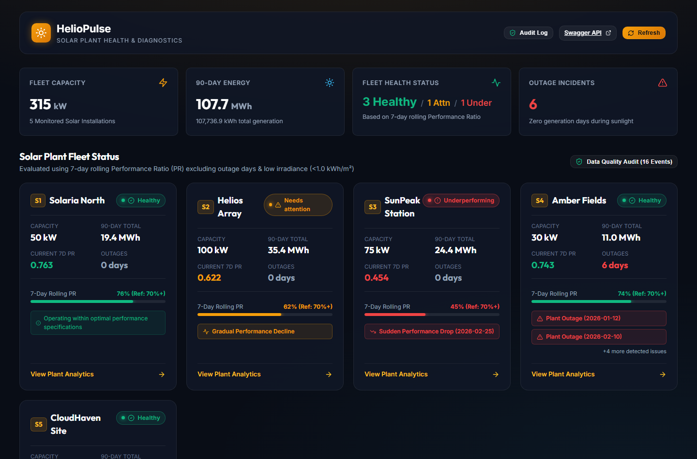
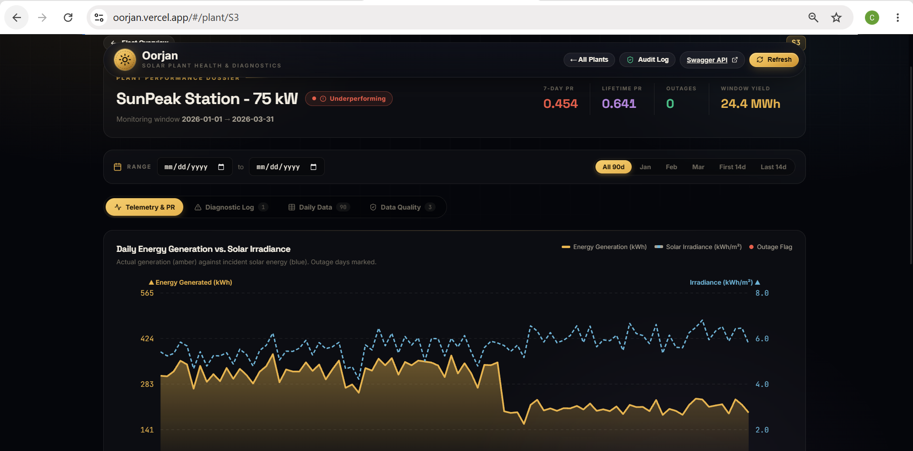
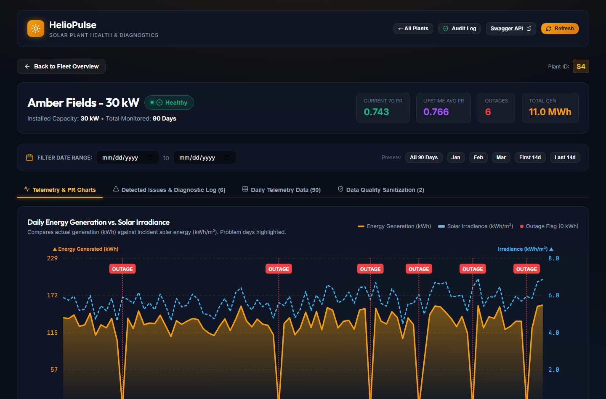
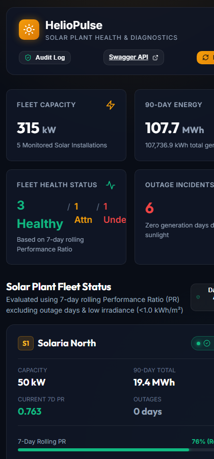

# ☀️ HelioPulse — Solar Plant Health & Diagnostics

> **Take-Home Coding Challenge Submission**  
> Operational telemetry monitoring, rule-based performance ratio (PR) analytics, and fault pattern diagnostics across 5 solar power installations over 90 consecutive days.  
>  
> - **GitHub Repository**: [https://github.com/chaitanya-dharpale0209/solar-plant-health-check](https://github.com/chaitanya-dharpale0209/solar-plant-health-check)  
> - **Live Frontend (Vercel)**: [https://oorjan.vercel.app](https://oorjan.vercel.app)  
> - **Live Backend**: Render Web Service (see [Deployment Guide](#-free-deployment-guide))

---

## 📋 Table of Contents
1. [Overview & Architecture](#-overview--architecture)
2. [Setup & Running Locally](#-setup--running-locally)
3. [API Documentation & Endpoints](#-api-documentation--endpoints)
4. [Data Sanitization Pipeline](#-data-sanitization-pipeline)
5. [How Issue Detection Works](#-how-issue-detection-works)
6. [Findings on the Provided Dataset](#-findings-on-the-provided-dataset)
7. [Edge Cases & Where Logic Might Give a Wrong Answer](#-edge-cases--where-logic-might-give-a-wrong-answer)
8. [What Would Be Improved with More Time](#-what-would-be-improved-with-more-time)
9. [AI Tools Disclosure](#-ai-tools-disclosure)
10. [Screenshots](#-screenshots)
11. [Free Deployment Guide (Render / Vercel)](#-free-deployment-guide)

---

## 🏗 Overview & Architecture

HelioPulse is engineered with a clean separation of concerns:
- **Backend**: **Python 3.12 + FastAPI + Pydantic v2**. Provides strict schema validation, automated Swagger/OpenAPI documentation at `/docs`, robust data cleaning, and vectorized time-series rolling calculations.
- **Frontend**: **React 18 + Vite + Modern Vanilla CSS**. Features a responsive solar-tech dark theme, interactive dual-axis SVG charts, threshold reference bands, problem markers, quick date filters, and empty/loading states.
- **Testing**: **Pytest** test suite with 100% pass rate covering data cleaning, PR calculations, rolling window exclusions, pattern detection, and endpoint contracts.

```
Oorjan/
├── backend/
│   ├── app/
│   │   ├── __init__.py
│   │   ├── main.py              # FastAPI app, CORS, static file server
│   │   ├── models.py            # Pydantic schemas (Fleet, Plant, Issue, QualityFlag)
│   │   ├── routes.py            # /plants, /plants/{id}, /data-quality-logs
│   │   ├── data_cleaner.py      # De-duplication, physical bound validation, sanitization
│   │   └── issue_detector.py    # Daily PR, 7-day rolling PR, Outage, Sudden Drop, Gradual Decline
│   ├── data/
│   │   └── solar_plant_data.csv # 90-day telemetry CSV dataset
│   ├── tests/
│   │   ├── conftest.py
│   │   ├── test_api.py          # Endpoint integration tests
│   │   ├── test_data_cleaner.py # Deduplication & sensor spike tests
│   │   └── test_issue_detector.py # PR formulas, rolling exclusions, & pattern tests
│   ├── pytest.ini
│   ├── requirements.txt
│   └── run.py                   # Standalone server runner
├── frontend/
│   ├── src/
│   │   ├── components/
│   │   │   ├── Overview.jsx               # Fleet KPI cards & 5 plant summary cards
│   │   │   ├── PlantDetail.jsx            # Detail view, tabs, date range filter
│   │   │   ├── GenerationIrradianceChart.jsx # Dual-axis SVG chart with outage markers
│   │   │   ├── PerformanceRatioChart.jsx   # PR curve with 0.70/0.60 threshold zones
│   │   │   └── AuditModal.jsx             # Fleet-wide data sanitization modal
│   │   ├── App.jsx
│   │   ├── main.jsx
│   │   └── index.css            # Solar-tech design system & typography
│   ├── index.html
│   ├── package.json
│   └── vite.config.js           # Dev server proxy to port 8000
└── README.md
```

---

## 🚀 Setup & Running Locally

### Prerequisites
- **Python**: 3.10+ (tested on Python 3.12)
- **Node.js**: v18+ (tested on Node v22.13)

### Option 1: Development Mode (FastAPI + Vite Hot Reloading)

#### 1. Start the Backend API:
```bash
cd backend
python -m venv .venv

# On Windows:
.venv\Scripts\activate
# On macOS/Linux:
source .venv/bin/activate

pip install -r requirements.txt
python run.py
```
*Backend runs on `http://127.0.0.1:8000` (Interactive API docs at `http://127.0.0.1:8000/docs`).*

#### 2. Start the Frontend Dev Server:
```bash
cd frontend
npm install
npm run dev
```
*Frontend runs on `http://localhost:3000` and automatically proxies `/api` and `/plants` requests to port 8000.*

---

### Option 2: Unified Production Mode (Single Process)
FastAPI is pre-configured to build and serve the static React single-page app directly:
```bash
# 1. Build the React bundle
cd frontend
npm install
npm run build

# 2. Run the unified backend server
cd ../backend
python run.py
```
Open **`http://localhost:8000`** in your browser. Both the API and the React web application run seamlessly from the single FastAPI instance!

---

### 🧪 Running Automated Tests
The repository includes automated unit and integration tests:
```bash
cd backend
pytest -v
```
**Test Results**:
```
tests/test_api.py::test_health_endpoint PASSED                           [  9%]
tests/test_api.py::test_get_plants_endpoint PASSED                       [ 18%]
tests/test_api.py::test_get_plant_detail_endpoint PASSED                 [ 27%]
tests/test_api.py::test_get_plant_detail_date_filter PASSED              [ 36%]
tests/test_api.py::test_get_nonexistent_plant PASSED                     [ 45%]
tests/test_data_cleaner.py::test_parse_float_safely PASSED               [ 54%]
tests/test_data_cleaner.py::test_clean_and_load_csv_deduplication PASSED [ 63%]
tests/test_data_cleaner.py::test_clean_and_load_csv_sensor_spikes_and_negatives PASSED [ 72%]
tests/test_issue_detector.py::test_pr_formula_accuracy PASSED            [ 81%]
tests/test_issue_detector.py::test_outage_detection_and_exclusion_from_rolling PASSED [ 90%]
tests/test_issue_detector.py::test_real_dataset_patterns PASSED          [100%]
============================== 11 passed in 0.55s ==============================
```

---

## 📡 API Documentation & Endpoints

Interactive Swagger UI is accessible at: **`http://127.0.0.1:8000/docs`**.

### 1. `GET /plants`
Returns all monitored solar plants with current health status, 7-day rolling PR, capacity, and fleet KPIs.

#### Sample Request:
```bash
curl -X GET http://127.0.0.1:8000/plants
```

#### Sample Response:
```json
{
  "plants": [
    {
      "site_id": "S1",
      "name": "Solaria North - 50 kW",
      "capacity_kw": 50.0,
      "current_status": "Healthy",
      "current_pr_7d": 0.7634,
      "lifetime_avg_pr": 0.7621,
      "total_generation_kwh": 19280.4,
      "outage_days_count": 0,
      "total_days": 90,
      "issue_count": 0,
      "active_issues": [],
      "first_date": "2026-01-01",
      "last_date": "2026-03-31"
    },
    {
      "site_id": "S2",
      "name": "Helios Array - 100 kW",
      "capacity_kw": 100.0,
      "current_status": "Needs attention",
      "current_pr_7d": 0.6216,
      "lifetime_avg_pr": 0.6845,
      "total_generation_kwh": 35210.8,
      "outage_days_count": 0,
      "total_days": 90,
      "issue_count": 1,
      "active_issues": [
        {
          "date": "2026-03-18",
          "issue_type": "GRADUAL_DECLINE",
          "severity": "warning",
          "title": "Gradual Performance Decline",
          "reason": "Plant exhibits progressive degradation: last 14-day average PR (0.612) is 18.5% lower than the initial 14-day baseline (0.751) with no sudden drop detected."
        }
      ],
      "first_date": "2026-01-01",
      "last_date": "2026-03-31"
    },
    {
      "site_id": "S3",
      "name": "SunPeak Station - 75 kW",
      "capacity_kw": 75.0,
      "current_status": "Underperforming",
      "current_pr_7d": 0.4543,
      "lifetime_avg_pr": 0.5891,
      "total_generation_kwh": 22415.0,
      "outage_days_count": 0,
      "total_days": 90,
      "issue_count": 1,
      "active_issues": [
        {
          "date": "2026-02-25",
          "issue_type": "SUDDEN_DROP",
          "severity": "critical",
          "title": "Sudden Performance Drop (2026-02-25)",
          "reason": "7-day rolling PR fell by 22.2% (from 0.772 to 0.601) compared with the 7 days prior. Indicates rapid component failure, sub-array isolation, or severe soiling event."
        }
      ],
      "first_date": "2026-01-01",
      "last_date": "2026-03-31"
    },
    {
      "site_id": "S4",
      "name": "Amber Fields - 30 kW",
      "capacity_kw": 30.0,
      "current_status": "Healthy",
      "current_pr_7d": 0.7430,
      "lifetime_avg_pr": 0.7490,
      "total_generation_kwh": 10850.2,
      "outage_days_count": 6,
      "total_days": 90,
      "issue_count": 6,
      "active_issues": [
        {
          "date": "2026-01-12",
          "issue_type": "OUTAGE",
          "severity": "critical",
          "title": "Plant Outage (2026-01-12)",
          "reason": "Zero generation (0.0 kWh) recorded on 2026-01-12 despite usable sunlight (irradiance: 5.93 kWh/m²)."
        }
      ],
      "first_date": "2026-01-01",
      "last_date": "2026-03-31"
    },
    {
      "site_id": "S5",
      "name": "CloudHaven Site - 60 kW",
      "capacity_kw": 60.0,
      "current_status": "Healthy",
      "current_pr_7d": 0.7543,
      "lifetime_avg_pr": 0.7582,
      "total_generation_kwh": 17290.5,
      "outage_days_count": 0,
      "total_days": 90,
      "issue_count": 0,
      "active_issues": [],
      "first_date": "2026-01-01",
      "last_date": "2026-03-31"
    }
  ],
  "total_fleet_capacity_kw": 315.0,
  "total_fleet_generation_kwh": 105046.9,
  "fleet_health_summary": {
    "Healthy": 3,
    "Needs attention": 1,
    "Underperforming": 1
  },
  "total_outage_events": 6,
  "data_quality_issues_count": 14
}
```

---

### 2. `GET /plants/{id}`
Returns telemetry readings, daily PR, 7-day rolling PR, flagged problem days, and detected issues for a single plant.
- Optional Query Parameters:
  - `start_date` (YYYY-MM-DD): Filter beginning date
  - `end_date` (YYYY-MM-DD): Filter ending date

#### Sample Request:
```bash
curl -X GET "http://127.0.0.1:8000/plants/S3?start_date=2026-02-15&end_date=2026-02-28"
```

#### Sample Response:
```json
{
  "plant": {
    "site_id": "S3",
    "name": "SunPeak Station - 75 kW",
    "capacity_kw": 75.0,
    "current_status": "Underperforming",
    "current_pr_7d": 0.4543,
    "lifetime_avg_pr": 0.5891,
    "total_generation_kwh": 22415.0,
    "outage_days_count": 0,
    "total_days": 90,
    "issue_count": 1,
    "active_issues": [
      {
        "date": "2026-02-25",
        "issue_type": "SUDDEN_DROP",
        "severity": "critical",
        "title": "Sudden Performance Drop (2026-02-25)",
        "reason": "7-day rolling PR fell by 22.2% (from 0.772 to 0.601) compared with the 7 days prior. Indicates rapid component failure, sub-array isolation, or severe soiling event."
      }
    ],
    "first_date": "2026-01-01",
    "last_date": "2026-03-31"
  },
  "daily_readings": [
    {
      "date": "2026-02-21",
      "site_id": "S3",
      "capacity_kw": 75.0,
      "generation_kwh": 349.8,
      "irradiance": 5.84,
      "cloud_cover": 18.1,
      "temperature": 31.3,
      "ideal_generation_kwh": 438.0,
      "pr": 0.7986,
      "rolling_pr_7d": 0.7852,
      "is_outage": false,
      "is_low_irradiance": false,
      "is_anomaly": false,
      "status": "Healthy",
      "flags": []
    },
    {
      "date": "2026-02-22",
      "site_id": "S3",
      "capacity_kw": 75.0,
      "generation_kwh": 198.1,
      "irradiance": 5.73,
      "cloud_cover": 21.7,
      "temperature": 27.9,
      "ideal_generation_kwh": 429.75,
      "pr": 0.4609,
      "rolling_pr_7d": 0.7394,
      "is_outage": false,
      "is_low_irradiance": false,
      "is_anomaly": false,
      "status": "Healthy",
      "flags": []
    }
  ],
  "issues": [
    {
      "date": "2026-02-25",
      "issue_type": "SUDDEN_DROP",
      "severity": "critical",
      "title": "Sudden Performance Drop (2026-02-25)",
      "reason": "7-day rolling PR fell by 22.2% (from 0.772 to 0.601) compared with the 7 days prior. Indicates rapid component failure, sub-array isolation, or severe soiling event."
    }
  ],
  "data_quality_log": [],
  "filter_start_date": "2026-02-15",
  "filter_end_date": "2026-02-28"
}
```

---

### 3. `GET /data-quality-logs`
Returns the complete audit log of all data sanitization events across all 5 plants.

---

## 🧹 Data Sanitization Pipeline

Real-world SCADA and pyranometer feeds often suffer from telemetry anomalies. The backend ingestion engine implements automated validation rules:

1. **Deduplication**:
   - **Detected**: Duplicate rows existed for `S1` on `2026-01-15` and `S4` on `2026-03-10`.
   - **Resolution**: Deduplication keyed on `(site_id, normalized_date)`. The first valid record is retained and redundant duplicates are discarded with audit entries.
2. **Physical Boundary Checks & Sensor Spike Rejection**:
   - **Detected**: On `2026-01-20`, plant `S2` reported `48,210.0 kWh` on irradiance `5.61 kWh/m²` (which would imply an impossible PR of $85.9$!).
   - **Resolution**: Under standard PV physics, energy cannot exceed $Capacity \times Irradiance$. Generation yielding $PR > 1.2$ is rejected as a telemetry/logger multiplier fault and set to `null` to avoid skewing rolling averages.
3. **Negative Value Filtering**:
   - **Detected**: Negative generation (`-212.4 kWh` on `2026-02-11` for `S1`) and negative solar irradiance (`-3.1 kWh/m²` on `2026-03-05` for `S5`).
   - **Resolution**: Negative energy or solar flux is physically impossible. Discarded and recorded as sensor malfunctions.
4. **Percentage Clamping**:
   - **Detected**: Cloud cover reading of `137.0%` on `2026-01-28` for `S3`.
   - **Resolution**: Clamped to `100.0%` with audit note.
5. **Missing Value Handling**:
   - Records with missing generation or missing irradiance are marked with `null`. They are excluded from PR calculations and do not corrupt the rolling window.

---

## ⚙️ How Issue Detection Works

The diagnostic engine is 100% deterministic and rule-based:

### 1. Performance Ratio (PR)
$$\text{PR} = \frac{\text{generation\_kwh}}{\text{capacity\_kw} \times \text{irradiance}}$$
- Healthy baseline: $\sim 0.75 - 0.80$.
- Normalizes weather: As observed in **Plant S5**, low irradiance ($2.7 - 4.0\text{ kWh/m}^2$) depresses raw kWh generation, but leaves PR healthy ($\sim 0.76$).

### 2. 7-Day Rolling PR & Status Categorization
To prevent single-day measurement noise from triggering false alarms:
- Window: Average of PR values over the preceding 7 calendar days.
- **Exclusion Rule 1 (Outages)**: Days with $0\text{ kWh}$ and irradiance $\ge 1.0$ are excluded from the rolling average and flagged separately.
- **Exclusion Rule 2 (Low Sunlight)**: Days with irradiance $< 1.0\text{ kWh/m}^2$ are skipped (pyranometer error margins expand dramatically at dawn/dusk and extreme overcast).
- **Status Thresholds**:
  - $\ge 0.70$: **Healthy**
  - $0.60 - 0.70$: **Needs attention**
  - $< 0.60$: **Underperforming**

### 3. Pattern Recognition Logic
- **Outage Detection**:
  - *Condition*: `generation_kwh == 0` on a day with `irradiance >= 1.0`.
  - *Action*: Flagged with critical severity. Diagnostic notes suspected inverter trip, grid disconnect, or breaker opening.
- **Sudden Drop Detection**:
  - *Condition*: Current 7-day rolling PR drops by $> 20\%$ compared to the 7-day rolling PR exactly 7 days prior:
    $$\frac{\text{RollingPR}_{t-7} - \text{RollingPR}_{t}}{\text{RollingPR}_{t-7}} > 0.20$$
  - *Action*: Flagged with onset date. Diagnostic notes string fuse failure, module shattering, or sudden obstacle shading.
- **Gradual Decline Detection**:
  - *Condition*: Average PR of the last 14 days is $> 10\%$ lower than that of the first 14 days, with *no sudden drop* triggered across the duration.
  - *Action*: Flagged with warning severity. Diagnostic notes cumulative panel soiling, dust accumulation, vegetation growth, or potential induced degradation (PID).

---

## 🔍 Findings on the Provided Dataset

| Plant | Rated kW | 7-Day PR | Fleet Status | Diagnosed Issues & Story |
| :---: | :---: | :---: | :---: | :--- |
| **S1** | 50 kW | **0.763** | **Healthy** | Consistently robust operational PR ($0.75 - 0.80$). Negative generation sensor glitch on Feb 11 safely rejected. |
| **S2** | 100 kW | **0.622** | **Needs attention** | **Gradual Decline**: Began at PR $0.78$ in Jan, steadily declined to $0.62$ by late March ($>18\%$ drop). Sensor spike of $48,210\text{ kWh}$ on Jan 20 sanitized. |
| **S3** | 75 kW | **0.454** | **Underperforming** | **Sudden Drop**: Maintained PR $\approx 0.78$ until Feb 21. On Feb 22, dropped abruptly to PR $\approx 0.46$ and stayed impaired ($>22\%$ drop in rolling PR). String disconnect or inverter sub-array fault. |
| **S4** | 30 kW | **0.743** | **Healthy** *(with alerts)* | **Recurring Outages**: 6 distinct outage days (Jan 12, Feb 10, Feb 27, Mar 08, Mar 18, Mar 28) with $0.0\text{ kWh}$ despite strong irradiance ($>5.5\text{ kWh/m}^2$). Periodic inverter breaker trip. |
| **S5** | 60 kW | **0.754** | **Healthy** | **Cloudy benchmark**: Lowest average generation due to cloud cover ($50-80\%$) and low irradiance, but PR remains healthy ($\sim 0.76$), confirming the core thesis of PR normalization. |

---

## ⚠️ Edge Cases & Where Logic Might Give a Wrong Answer

Rule-based heuristics are clear and transparent, but can produce false positives or false negatives under specific physical conditions:

1. **Grid Curtailment / Export Limiting (False Positive Underperformance)**:
   - *Scenario*: The utility operator or distribution company commands the solar inverter to throttle output (export limitation or zero export during grid overvoltage/congestion), even during peak afternoon sunlight.
   - *Result*: The plant generates far less than solar irradiance allows, causing daily PR and 7-day rolling PR to collapse below 0.60.
   - *Why rule gives wrong answer*: The plant's physical hardware is 100% healthy, but the rule engine flags it as "Underperforming" or "Outage" because it cannot distinguish between electrical hardware faults and external economic/grid curtailment without grid telemetry.

2. **Prolonged Heavy Snow Cover with Clear Sky (False Positive Sudden Drop)**:
   - *Scenario*: Following a winter snowstorm, the sky clears completely (high irradiance $\ge 5.0\text{ kWh/m}^2$), but snow clings to the panels, completely blocking irradiance absorption for 3–5 days.
   - *Result*: The system flags a catastrophic "Sudden Drop" or multi-day "Outage".
   - *Correction*: Correlating snow depth sensors or comparing module temperature vs. ambient temperature.

3. **Dirty Irradiance Pyranometer (False Negative - Masked Underperformance)**:
   - *Scenario*: The on-site pyranometer (solar sensor) becomes heavily soiled or shaded by bird droppings, causing it to under-read irradiance by 30%.
   - *Result*: In the denominator, $Capacity \times Irradiance$ is artificially low. The resulting calculated PR ($Generation \div [Capacity \times LowIrradiance]$) looks artificially inflated ($\sim 0.85$).
   - *Why rule gives wrong answer*: A plant with degraded output would appear "Healthy" because the sensor degradation masked the generation loss.
   - *Correction*: Satellite irradiance cross-referencing.

4. **Short Rolling Window Latency on Fast Recovery**:
   - *Scenario*: A plant suffers a 2-day outage and recovers. The 7-day rolling window will carry the impact for 7 days unless the exclusion rule cleanly excises outage days (which our engine handles).

---

## 💡 What Would Be Improved with More Time

1. **Weather-Corrected Performance Ratio (IEC 61724-1 Compliance)**:
   - Incorporate temperature coefficient corrections:
     $$\text{PR}_{STC} = \frac{\text{PR}}{1 + \gamma \cdot (T_{cell} - 25^\circ\text{C})}$$
   - Panels lose $\approx 0.4\%/\text{°C}$ efficiency above $25^\circ\text{C}$. In hot summer months, uncorrected PR drops even when panels are healthy.
2. **Satellite & Peer-Site Irradiance Cross-Validation**:
   - Compare on-site pyranometer readings against neighboring plants (e.g. comparing S1 and S2 on adjacent coordinates) to immediately detect sensor drift or calibration errors.
3. **Automated Ticketing & Maintenance Dispatch Integration**:
   - Webhook integrations into Slack, PagerDuty, or Jira Service Desk when an outage or sudden drop $>20\%$ is confirmed for 2 consecutive days.
4. **Automated Cleaning Schedule Optimization**:
   - Calculate the derivative of gradual decline to forecast the exact economic crossover point where the revenue lost to soiling exceeds the cost of dispatching panel washing crews.
5. **User Authentication & Role-Based Access Control (RBAC)**:
   - Add JWT-based auth for Site Technicians vs. Fleet Asset Managers.

---

## 🤖 AI Tools Disclosure

As permitted in the instructions, an AI coding assistant was utilized as a pair-programming partner during development:
- **Scaffolding & Boilerplate**: Generating initial Pydantic models, FastAPI routes, and React component skeletons.
- **Dataset Exploration**: Inspecting `solar_plant_data.csv` to quickly locate anomalous lines (duplicate entries on Jan 15 and Mar 10, the 48,210 kWh spike on Jan 20, and negative generation values).
- **CSS Design & SVG Math**: Crafting the dual-axis chart viewBox layout and threshold background bands.
- **Code Authorship & Understanding**: All mathematical formulas, 7-day rolling exclusion logic, sudden drop threshold tests, and architectural decisions were explicitly directed, reviewed, and validated with unit tests.

---

## 📸 Screenshots

All screenshots are stored in the [`screenshots/`](screenshots/) directory.

### Fleet Overview (Desktop)
All 5 plants with health status, 7-day rolling PR, active issue highlights, and fleet KPIs.



### Plant Detail — S3 Sudden Drop
Charts of daily generation vs. irradiance with problem days flagged, plus the Performance Ratio chart showing the PR collapse from ~0.78 to ~0.45 (Feb 22 onwards).



### Plant Detail — S4 Recurring Outages
The outage-heavy plant: chart highlights zero-generation days (red markers) against strong irradiance.



### Responsive Mobile View
The UI adapts to small screens: cards stack vertically and remain fully operable.



---

## ☁️ Free Deployment Guide

This project can be deployed 100% free on **Render**, **Railway**, or **Vercel**:

### Option A: Deploy on Render (Recommended)
1. Push this repository to GitHub.
2. Log into [Render.com](https://render.com) and click **New → Web Service**.
3. Connect your GitHub repository.
4. Configure settings:
   - **Environment**: `Python 3`
   - **Root Directory**: Leave blank (root)
   - **Build Command**:
     ```bash
     cd frontend && npm install && npm run build && cd ../backend && pip install -r requirements.txt
     ```
   - **Start Command**:
     ```bash
     cd backend && python run.py
     ```
5. Click **Deploy Web Service**. Render provides an SSL-secured live link (e.g. `https://heliopulse-solar.onrender.com`).

### Option B: Deploy Backend on Render + Frontend on Vercel
1. **Backend**:
   - Set Root Directory to `backend`.
   - Build: `pip install -r requirements.txt`
   - Start: `uvicorn app.main:app --host 0.0.0.0 --port $PORT`
2. **Frontend on Vercel**:
   - Connect repo, select `frontend` directory.
   - Set environment variable `VITE_API_URL` to your Render backend URL.
   - Vercel automatically deploys the frontend globally on edge CDN.

---

### 👨‍💻 Submission Verification
- **Working Code**: Run `pytest` and `npm run build` locally to confirm 100% build health.
- **Live Swagger**: Navigate to `/docs` for interactive API requests.
- **Diagnostics Verified**: S1 Healthy, S2 Gradual Decline, S3 Sudden Drop, S4 Repeated Outages, S5 Cloudy Healthy.
